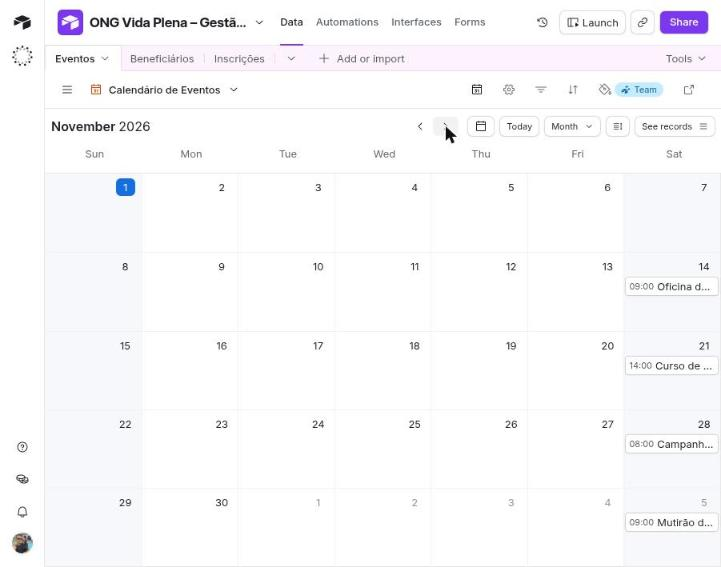
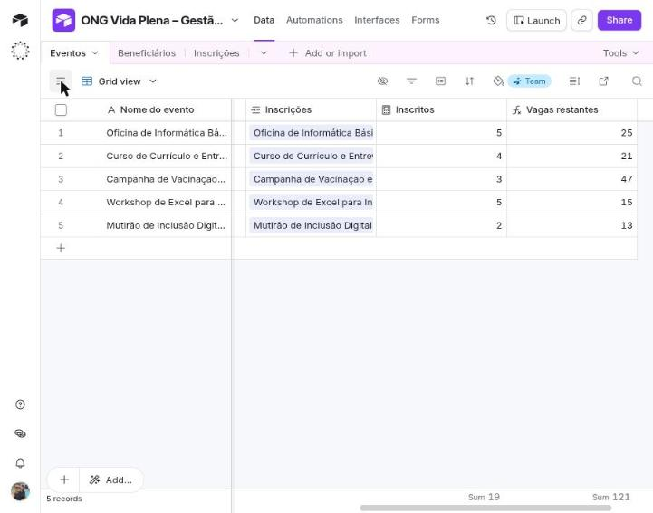
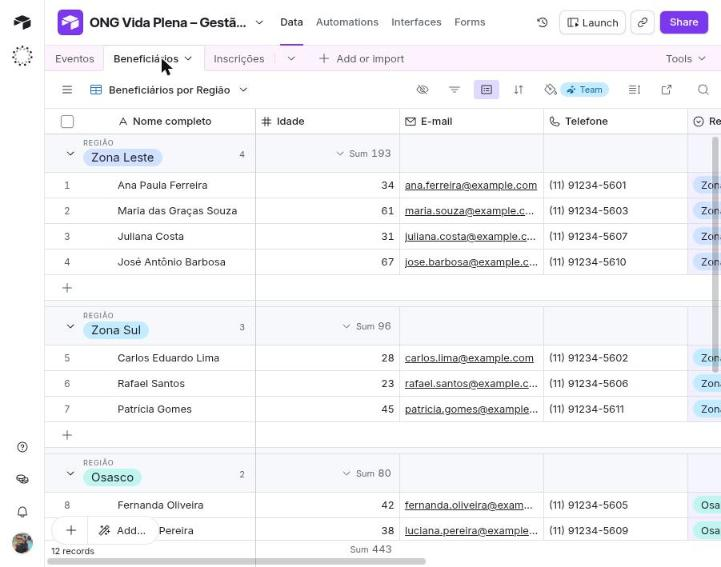
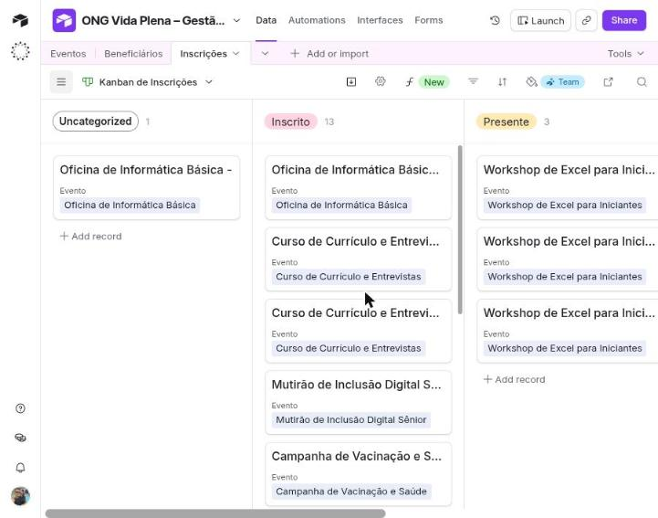
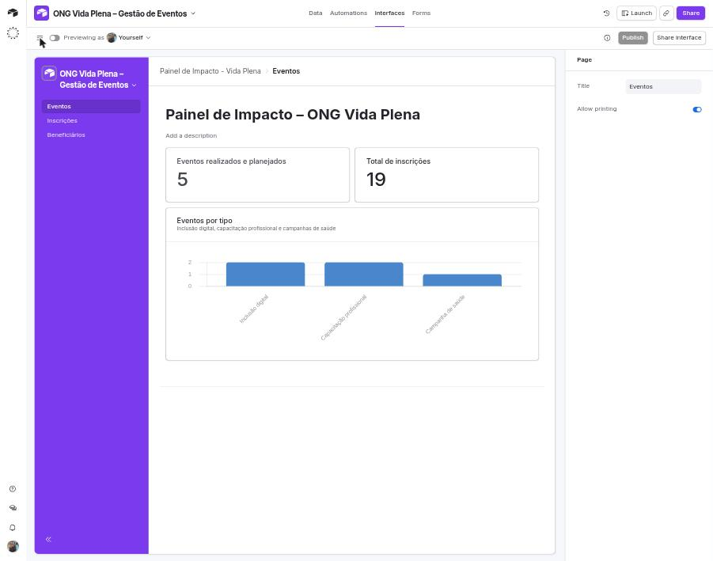
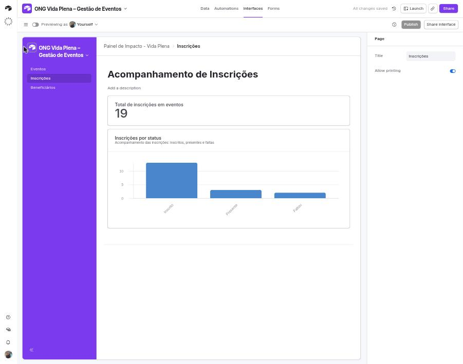
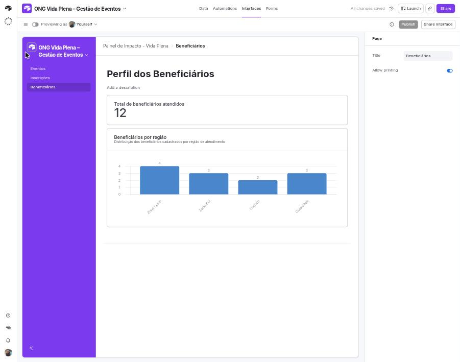
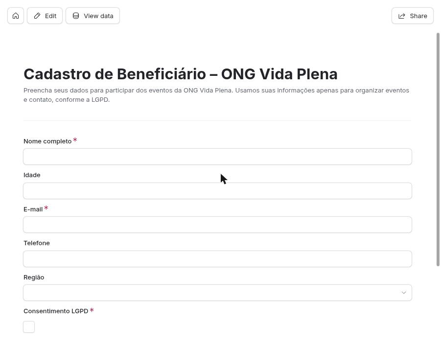
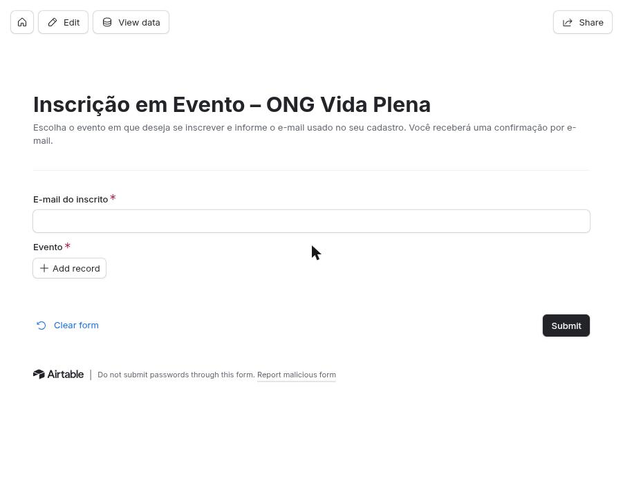
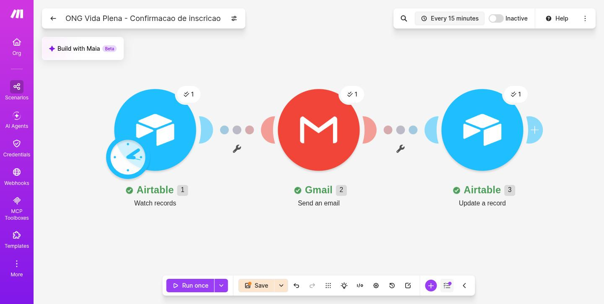

# ONG Vida Plena – Gestão de Eventos (Airtable + Make)

Projeto da disciplina *Construindo Aplicações Visuais com Integração em Plataformas No-Code e Low-Code* (UniFECAF).

A ONG fictícia **Vida Plena** precisa organizar eventos comunitários (inclusão digital, capacitação profissional e campanhas de saúde), cadastrar beneficiários, inscrevê-los em um ou mais eventos e acompanhar tudo em painéis visuais. A solução foi construída sem código, com **Airtable** (banco de dados visual, formulários e painéis) e **Make.com** (automação de e-mail).

> Todos os dados são **fictícios** (e-mails `@example.com`, telefones de exemplo).

## Requisitos e como foram atendidos

| Requisito | Solução |
|---|---|
| Cadastrar e visualizar eventos planejados | Tabela **Eventos** + visão de **Calendário** |
| Cadastrar beneficiários (nome, idade, contato, região) | Tabela **Beneficiários** + formulário público de cadastro |
| Inscrever o mesmo beneficiário em vários eventos, com histórico | Tabela **Inscrições** (tabela de ligação) |
| Notificação automática por e-mail | Cenário no **Make**: nova inscrição → e-mail de confirmação |
| Dados organizados, acessíveis e seguros | Modelo relacional, painéis, consentimento LGPD e dados mínimos |

## Modelo de dados

```
Eventos (1) ───< Inscrições >─── (1) Beneficiários
```

Um evento tem muitas inscrições e um beneficiário pode ter muitas inscrições. A tabela **Inscrições** liga as duas e resolve a relação muitos-para-muitos, mantendo o histórico de participação.

- **Eventos:** Nome do evento, Tipo, Data, Local, Região, Vagas, Status, Inscritos (contagem) e Vagas restantes (fórmula `Vagas - Inscritos`).
- **Beneficiários:** Nome completo, Idade, E-mail, Telefone, Região e Consentimento LGPD.
- **Inscrições:** Evento, Beneficiário, Status (Inscrito, Presente, Faltou), Data da inscrição (automática), E-mail do inscrito e E-mail enviado (marcado pelo Make).

## Visões e painéis

| | |
|---|---|
|  |  |
| Calendário de eventos | Eventos com inscritos e vagas restantes |
|  |  |
| Beneficiários agrupados por região | Kanban das inscrições por status |

Painel de impacto (Airtable Interfaces), com três páginas:





## Formulários públicos

- Cadastro de beneficiário: <https://airtable.com/appsk9aYkezMbL5cm/pagZajR8LeB3lKqCk/form>
- Inscrição em evento: <https://airtable.com/appsk9aYkezMbL5cm/pag9wI95YC0DGLVmX/form>




O formulário de inscrição pede apenas o **e-mail** e o **evento**. O campo de beneficiário fica oculto de propósito, para que a lista de nomes não apareça publicamente.

## Automação (Make.com)

Cenário **ONG Vida Plena – Confirmação de inscrição**:

1. **Airtable – Watch records** (tabela Inscrições). Filtra com `AND({E-mail do inscrito}, NOT({E-mail enviado}))`, processando só inscrições novas que ainda não receberam e-mail.
2. **Gmail – Send an email** para o "E-mail do inscrito", com a confirmação da inscrição.
3. **Airtable – Update a record** marca **E-mail enviado** como verdadeiro, evitando reenvio.



**Teste realizado:** uma inscrição enviada pelo formulário público gerou um novo registro, o Make executou os três módulos com sucesso, o e-mail de confirmação foi recebido e o registro ficou marcado como enviado.

## Ética, privacidade e segurança (LGPD)

- **Dados fictícios** em todo o projeto.
- **Consentimento explícito** (checkbox obrigatório) no cadastro, com texto explicando a finalidade.
- **Minimização:** só são coletados dados necessários para organizar eventos e contato.
- **Exposição controlada:** os formulários públicos não listam beneficiários; os painéis ficam restritos a colaboradores da base.
- **Conexões OAuth** do Airtable e do Gmail no Make, sem senhas no cenário.

## Limites do plano gratuito

O Make verifica novas inscrições a cada 15 minutos, então o e-mail não é instantâneo. O Airtable limita validação de e-mail nos formulários, logo e capa personalizados, linha do tempo/Gantt e o número de execuções de automação.

## Outros usos

A mesma estrutura serve para escolas (turmas e matrículas), clínicas (campanhas e atendimentos) e outras ONGs (voluntários e ações).
